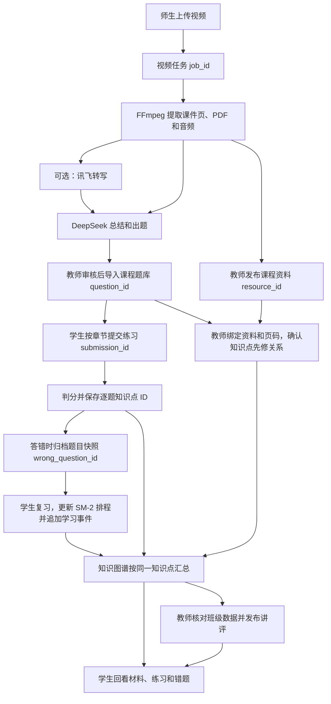

# 知学项目现状与数据流

知学是由本地 FastAPI 服务和原生 HTML、CSS、JavaScript 组成的教学 Demo。教师准备材料、题目和教学班，学生在有访问权限的班级内学习与答题。知识图谱使用同一教学班下的知识点，把材料出处、练习结果和复习安排接到同一节点。

## 从视频到班级反馈

教师也可以直接发布图文讲义、维护人工题目。教师发布已保存的 AI 题目只复制题目快照，学生个人视频自测保存在独立记录中。课程图谱的练习统计以正式自主练习为依据。

## 数据如何关联

| 环节 | 关键字段 | 持久化和访问 |
| --- | --- | --- |
| 视频处理 | `job_id`、`owner_id`、页码、截图时间（秒） | `data/jobs/<job_id>/job.json` 和导出文件。任务详情与生成操作按账号校验。教师发布后，本班学生可访问课件页。 |
| 转写和 AI 产物 | `job_id`、`quiz_id`、题目版本 | 同一任务目录下保存转写 TXT、HTML、总结 HTML 和题目 JSON。转写处理有句子时间，现有 TXT 没有独立的结构化时间索引。 |
| 教学发布 | `course_id`、`chapter_id`、`resource_id`、`knowledge_point_id` | `data/learning-platform.json`。资源可关联已完成的视频任务。题库中的 AI 题目保留来源任务、题套版本与原题 ID，按班级去重。 |
| 知识图谱 | `course_id`、`knowledge_point_id`、`revision` | 同一课程 JSON 内保存教师确认的先修边和材料关联。知识点沿用课程题库的 ID，材料定位到课程资料或其中一页。 |
| 正式作答 | `submission_id`、`course_id`、`student_id`、`question_id`、`knowledge_point_id` | `submissions` 保存得分和逐题快照。独立作业另有 `assignment_id`，答案与解析按个人提交次数解锁。 |
| 错题与复习 | 错题记录 ID、题目快照、知识点 ID、下次复习时间 | `wrong_questions` 保存错题和排程，`learning_events` 记录实际复习。复习按原题快照判定，再更新间隔和打卡数据。 |
| 教学反馈 | 班级名单、作答及复习计数 | 学习档案、教师成绩册和公告各沿用原有入口。图谱实时读取本班的作答与复习数据，教师可发布知识点讲评公告。 |

## 代码入口

- [服务与课程接口](../demo/app.py)负责登录范围校验、发布、判分、复习、图谱接口和 JSON 落盘。
- [视频任务](../demo/jobs.py)、[视频提取](../demo/media.py)、[转写](../demo/transcriptions.py)和[AI 题目](../demo/quizzes.py)负责后台任务及产物。
- [图谱数据](../demo/knowledge_graph.py)负责关系校验、来源定位和统计。[图谱页面](../web/knowledge-graph.js)负责师生视图和教师编辑。

## 统计与历史记录

图谱按教学班 ID 隔离，同一个课程代码下的两个班分别统计。学生只能查看已发布且本人仍在名单中的班级图谱和自己的数据。教师只能查看本人教学班的汇总，汇总以当前有效名单为准。

图谱正确率的分母是带有效知识点 ID 的自主单选作答条数，同一题在不同提交中的答案分别计数。复习次数来自实际复习事件，题目快照和原始得分保留。历史作答只有名称时仍能在原学习记录中查看。删除资料或视频后，图谱保留历史来源标记并显示「来源不可用」。
